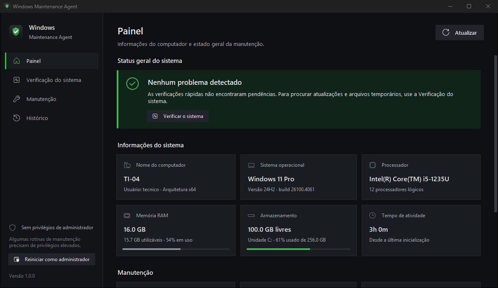
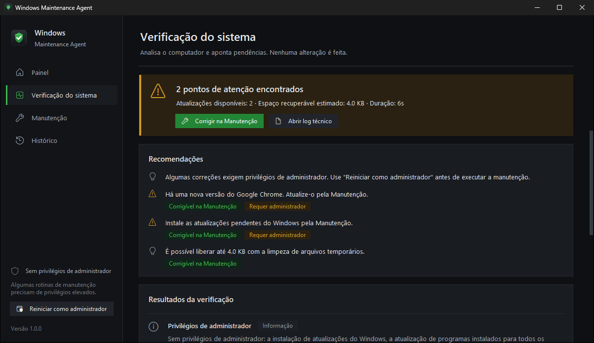
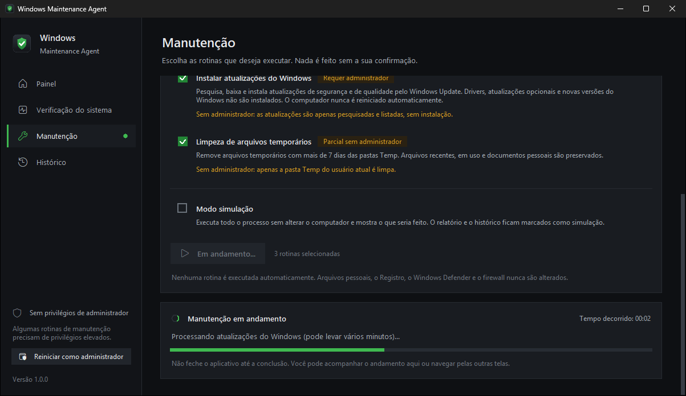

# Windows Maintenance Agent

Agente de **manutenção preventiva de estações Windows 10 e 11**, disponível como
**aplicativo desktop** (janela própria, em português, sem instalar nada) e como **linha de
comando** para técnicos e para o **Agendador de Tarefas do Windows**. Em uma única execução
ele identifica a máquina, verifica privilégios, atualiza o Google Chrome via winget, verifica
e instala atualizações do Windows pela API oficial do Windows Update, detecta reinicialização
pendente, limpa arquivos temporários com segurança, verifica o disco e registra tudo em
**logs, relatórios e histórico**.

> O agente **nunca** reinicia o computador, **nunca** desativa proteções do Windows e
> **nunca** baixa nem executa código da internet.



## Sumário

- [Aplicativo desktop](#aplicativo-desktop)
- [Problema](#problema)
- [Solução](#solução)
- [Funcionalidades: implementado x planejado](#funcionalidades-implementado-x-planejado)
- [Arquitetura](#arquitetura)
- [Tecnologias](#tecnologias)
- [Requisitos](#requisitos)
- [Instalação](#instalação)
- [Comandos](#comandos)
- [Configuração](#configuração)
- [Logs](#logs)
- [Relatórios](#relatórios)
- [Histórico](#histórico)
- [Sincronização com compartilhamento de rede](#sincronização-com-compartilhamento-de-rede)
- [Agendador de Tarefas](#agendador-de-tarefas)
- [Segurança](#segurança)
- [Testes](#testes)
- [Empacotamento (executável)](#empacotamento-executável)
- [Limitações](#limitações)
- [Troubleshooting](#troubleshooting)
- [Roadmap](#roadmap)
- [Estrutura do repositório](#estrutura-do-repositório)

## Aplicativo desktop

### Como baixar e abrir

1. Acesse a página de **[Releases](https://github.com/kelvinsg218/Windows-Maintenance-Agent/releases/latest)**
   e baixe o arquivo **`Windows-Maintenance-Agent-v1.0.0.exe`**.
2. Coloque-o em uma pasta própria (ex.: `Documentos\Windows Maintenance Agent`): o aplicativo
   é portátil e cria ao lado dele as pastas `logs`, `reports` e `data` (histórico).
3. Abra com **dois cliques**. Não é preciso instalar Python, abrir terminal nem configurar nada.

**Requisitos:** Windows 10 ou Windows 11 de 64 bits. O winget (App Installer, já presente no
Windows 11 e nas versões atuais do Windows 10) é usado somente para atualizar o Google Chrome.

> **Aviso do SmartScreen:** o executável ainda não tem assinatura digital. Na primeira
> execução o Windows pode exibir "O Windows protegeu o computador". Confira se o arquivo veio
> da página de Releases deste repositório (o SHA-256 está publicado na release) e clique em
> **Mais informações → Executar assim mesmo**.

### Telas

| Tela | O que faz |
|---|---|
| **Painel** | Nome do computador, usuário, Windows (versão e build), processador, memória RAM, armazenamento, tempo de atividade, privilégios, reinicialização pendente, última manutenção, Google Chrome e winget, além do **status geral do sistema**. |
| **Verificação do sistema** | Executa o `check` (somente leitura) com progresso por etapa: problemas encontrados, alertas, recomendações e quais pendências podem ser **corrigidas na Manutenção**. |
| **Manutenção** | Executa o `run` somente com as rotinas marcadas (Google Chrome, Windows Update, limpeza de temporários), com a descrição de cada uma, a indicação das que exigem administrador, **modo simulação**, confirmação, andamento e o resultado de cada etapa. |
| **Histórico** | Manutenções registradas neste computador (inclusive simulações), com o resultado detalhado de cada uma e acesso ao relatório e ao log. |

| Verificação do sistema | Manutenção |
|---|---|
|  |  |

*Capturas com dados de exemplo.* A interface usa tema escuro, se ajusta ao redimensionamento
da janela e nunca congela: verificações e manutenções rodam em segundo plano.

### Permissões de administrador

O aplicativo abre **sem pedir privilégios de administrador** e, assim, já mostra o painel,
faz a verificação completa, consulta o histórico, limpa a pasta Temp do usuário e atualiza o
Chrome instalado apenas para o usuário. Exigem administrador: **instalar atualizações do
Windows**, atualizar o Chrome instalado para todos os usuários e limpar `C:\Windows\Temp` e a
Temp dos outros perfis — sem elevação, essas etapas são apenas verificadas e informadas.

Quando precisar delas, use **Reiniciar como administrador** (barra lateral ou tela
Manutenção): o Windows exibe o prompt do UAC e a decisão é sua. O aplicativo nunca contorna o
UAC, nunca reinicia o computador e nenhuma rotina é executada sem a sua confirmação.

### Arquivos e configuração

O aplicativo usa a mesma estrutura da linha de comando: `logs\`, `reports\` e `data\` ao lado
do executável e, opcionalmente, um `config.json` na mesma pasta (veja
[Configuração](#configuração)). Para executar a partir do código-fonte:
`.\.venv\Scripts\maintenance-gui` ou `python -m maintenance.gui`.

## Problema

A manutenção preventiva de estações costuma ser manual, repetitiva e sem registro: cada
técnico segue um roteiro diferente, não há histórico do que foi feito em cada máquina e
problemas (atualização que falhou, disco cheio, reinicialização pendente) passam
despercebidos.

A abordagem anterior tentava automatizar isso com um `updater.py` que baixava um
`main_script.py` do GitHub e o executava a cada rodada. Isso significa **executar código
remoto arbitrário** com os privilégios da máquina: qualquer alteração no repositório (ou no
caminho até ele) seria executada sem revisão, sem versão definida e sem trilha de auditoria.

## Solução

O Windows Maintenance Agent é um **agente versionado**: todo o código está neste repositório,
é revisável, testado e distribuído como uma versão fechada (código-fonte, aplicativo desktop ou
`maintenance.exe`).
A abordagem de baixar e executar scripts remotos foi eliminada; futuras atualizações do agente
serão tratadas como novas releases verificadas (veja [Roadmap](#roadmap)).

Cada etapa da manutenção é um módulo isolado com resultado padronizado
(`SUCCESS`, `WARNING`, `FAILED`, `SKIPPED`). A falha de um módulo é registrada e a manutenção
continua; somente erros críticos interrompem a execução.

## Funcionalidades: implementado x planejado

### Implementado

| Área | O que faz |
|---|---|
| Identificação | Hostname, usuário da sessão, edição/versão/build do Windows (corrige o "Windows 10" que o Registro informa no Windows 11), arquitetura, uptime. |
| Privilégios | Detecta se o processo está elevado e identifica "administrador sem elevação". Nunca tenta se elevar. |
| Winget | Localiza o `winget.exe` (PATH, alias do usuário ou pasta do pacote, necessária na conta SYSTEM) e obtém a versão. |
| Google Chrome | Detecta pelo Registro (versão e escopo máquina/usuário); verifica e atualiza via winget usando apenas os IDs estáveis `Google.Chrome` e `Google.Chrome.EXE`, com timeout; stdout/stderr são capturados (últimas linhas no log em caso de falha) e exit code e duração ficam no log e no relatório JSON. |
| Windows Update | Pesquisa, baixa e instala pela Windows Update Agent API (COM), respeitando WSUS/políticas. Ignora drivers, atualizações opcionais e de recurso por padrão. Instala somente com privilégios administrativos. |
| Reinicialização | Detecta reinicialização pendente (CBS, Windows Update, UpdateExeVolatile, substituições em `PendingFileRenameOperations`, renomeação do computador) e a exigida pelas atualizações instaladas. **Nunca reinicia.** |
| Limpeza | Remove arquivos antigos do Temp do usuário, do `C:\Windows\Temp` e do Temp de todos os perfis (os dois últimos exigem admin), com validação estrita de caminhos. |
| Disco | Espaço total/livre/uso da unidade do sistema, antes e depois; alerta abaixo dos limites configurados. |
| Logs | Um arquivo por execução no formato `data \| NÍVEL \| mensagem`, com redação de segredos e retenção configurável. |
| Relatórios | Relatório `.txt` (para o técnico) e `.json` (estruturado) por execução. |
| Histórico | Banco SQLite local com todas as execuções de `run`. |
| Rede | Cópia opcional de log e relatórios para `\\SERVIDOR\...\<HOSTNAME>\`, sem credenciais e sem falhar a manutenção se o servidor estiver offline. |
| Agendamento | Scripts `install_task.ps1` / `remove_task.ps1` com `-WhatIf`. |
| Simulação | `check` (somente leitura) e `run --dry-run` (fluxo completo sem alterações). |
| Aplicativo desktop | Interface gráfica em português (Tkinter) sobre os mesmos fluxos `status`, `check` e `run`: painel, verificação, manutenção com confirmação, histórico e elevação sob demanda pelo UAC. |
| Empacotamento | `scripts/build_exe.ps1` gera o aplicativo desktop e o `maintenance.exe` (arquivos únicos, com ícone e informações de versão) com PyInstaller. |
| Atualização do agente | Apenas as validações preparatórias (`release.py`): comparação de versões, validação de manifesto (HTTPS, host autorizado, SHA-256) e verificação de hash. **Não há download.** |

### Planejado (ainda não implementado)

- Atualização automática do próprio agente por releases verificadas (download, assinatura, troca com backup e rollback).
- Reenvio ao compartilhamento de rede de relatórios gerados enquanto o servidor estava offline.
- Assinatura de código (Authenticode) dos executáveis.
- Registro de eventos no Log de Eventos do Windows.
- Verificação de todos os discos fixos (hoje: somente a unidade do sistema).
- Novos alvos de limpeza (cache do Windows Update com o serviço parado, Otimização de Entrega, relatórios do WER).
- Atualização de outros aplicativos via winget com lista de IDs aprovada.

## Arquitetura

```
maintenance (CLI)                 cli.py
Aplicativo desktop (GUI)          gui/ (app, páginas, widgets, tema, textos em pt-BR)
│
└── runner.py                     orquestra "check" e "run", isola falhas, bloqueio de execução
    ├── system_info.py            hostname, usuário, Windows, arquitetura, disco, uptime
    ├── privileges.py             administrador / elevação (ctypes)
    ├── winget.py                 localização do winget, list/upgrade, parser, exit codes
    ├── chrome.py                 Google Chrome (Registro + winget)
    ├── windows_update.py         Windows Update Agent API (COM via pywin32)
    ├── reboot.py                 reinicialização pendente (Registro)
    ├── cleanup.py                limpeza segura de temporários
    ├── reports.py                relatório .txt e .json
    ├── history.py                histórico SQLite
    └── network_sync.py           cópia para compartilhamento de rede

Suporte: config.py (config.json validado) · logging_service.py (logs, redação, retenção)
         process.py (subprocess seguro, timeouts) · registry.py (leitura do Registro)
         results.py (estados padronizados) · formatting.py · release.py (validações de release)
```

### Fluxo de `maintenance run`

1. Coleta as informações da máquina e cria o log da execução.
2. Verifica privilégios.
3. Verifica o winget.
4. Atualiza o Google Chrome.
5. Verifica/instala atualizações do Windows.
6. Verifica reinicialização pendente (incluindo a exigida pelas atualizações).
7. Limpa arquivos temporários.
8. Verifica o espaço em disco.
9. Finaliza o log com o resultado geral.
10. Gera o relatório (`.txt` e `.json`).
11. Registra a execução no histórico.
12. Sincroniza log e relatórios com o compartilhamento de rede (se configurado).

### Resultados

| Estado do módulo | Significado |
|---|---|
| `SUCCESS` | Etapa concluída. |
| `WARNING` | Concluída com pendência (ex.: atualização disponível sem privilégio para instalar). |
| `FAILED` | A etapa falhou; a manutenção segue para a próxima. |
| `SKIPPED` | Não solicitada, desabilitada, não aplicável ou simulada (dry-run). |

Resultado geral: **`FAILED`** em erro crítico ou quando todas as tarefas solicitadas
(Chrome, Windows Update, limpeza) falharam; **`SUCCESS_WITH_WARNINGS`** quando há qualquer
`WARNING`/`FAILED` ou reinicialização pendente; **`SUCCESS`** nos demais casos. Uma tarefa
opcional que falha não marca a manutenção inteira como `FAILED`.

## Tecnologias

- **Python 3.11+** (desenvolvido e testado com 3.13.5), priorizando a standard library:
  `argparse`, `sqlite3`, `winreg`, `ctypes`, `subprocess`, `logging`, `json`, `threading`.
- **pywin32** — única dependência de runtime, usada para acessar a Windows Update Agent API
  (COM). A standard library não oferece acesso adequado a automação COM, e usar PowerShell
  embutido deixaria a lógica fora dos testes em Python e falharia em máquinas com
  Constrained Language Mode (AppLocker/WDAC).
- **Tkinter** (biblioteca padrão) para o aplicativo desktop, sem dependências adicionais;
  os ícones vêm das fontes Segoe Fluent Icons / Segoe MDL2 Assets do próprio Windows.
- **winget** (App Installer da Microsoft) para o Google Chrome.
- Desenvolvimento: **pytest** e **ruff**. Empacotamento (opcional): **PyInstaller**.

## Requisitos

- Windows 10 ou 11 (x64 ou ARM64; os executáveis publicados são de 64 bits). PowerShell 5.1
  para os scripts de agendamento.
- Python 3.11+ para executar a partir do código-fonte (os executáveis não exigem Python).
- winget (App Installer) para verificar/atualizar o Chrome.
- Privilégios administrativos para: instalar atualizações do Windows, atualizar o Chrome
  instalado para todos os usuários e limpar `C:\Windows\Temp` e o Temp de outros perfis.
  Sem eles, o agente verifica e informa, mas não executa essas ações.

## Instalação

### A partir do código-fonte

```powershell
git clone <url-do-repositorio> windows-maintenance-agent
cd windows-maintenance-agent
python -m venv .venv
.\.venv\Scripts\python -m pip install -e ".[dev]"     # runtime + pytest/ruff
.\.venv\Scripts\maintenance --help
```

Alternativas: `pip install -r requirements.txt` (apenas runtime) ou
`pip install -r requirements-dev.txt`. Com o ambiente ativado
(`.\.venv\Scripts\Activate.ps1`), basta usar `maintenance <comando>`; também funciona
`python -m maintenance <comando>`.

### Configuração privada

```powershell
Copy-Item config.example.json config.json   # config.json não é versionado
```

Sem `config.json`, o agente usa os valores padrão (e avisa na saída).

## Comandos

| Comando | Descrição |
|---|---|
| `maintenance status` | Estado atual da máquina (rápido, somente leitura). |
| `maintenance check` | Verifica Chrome, Windows Update, disco, temporários e reinicialização **sem alterar nada**. |
| `maintenance run` | Manutenção completa, conforme as tarefas habilitadas no `config.json`. |
| `maintenance run --chrome` | Somente o Google Chrome. |
| `maintenance run --windows-update` | Somente o Windows Update. |
| `maintenance run --cleanup` | Somente a limpeza de temporários. |
| `maintenance run --dry-run` | Simula o fluxo completo sem alterar o computador (gera log, relatório e histórico marcados como DRY-RUN). |
| `maintenance report [--id N]` | Exibe o último relatório (ou o da execução `N`). |
| `maintenance history [--limit N]` | Lista as últimas execuções (padrão: 10). |
| `maintenance version` | Versão do agente. |
| `maintenance help [comando]` | Ajuda geral ou de um comando. |

As flags de tarefa podem ser combinadas (`run --chrome --cleanup`) e também valem para
`check`. Com flags, apenas as tarefas indicadas são executadas; sem flags, valem as chaves
`update_chrome`, `update_windows` e `cleanup_temp` do `config.json`.
Opções globais: `--config <arquivo>` e `-v/--verbose` (inclui mensagens de depuração no log).

**Códigos de saída:** `0` sucesso · `1` sucesso com pendências · `2` falha (inclui erro de
configuração ou de uso) · `130` interrompido. No `check`: `0` nada pendente, `1` há
pendências, `2` alguma verificação falhou.

### Exemplos de saída

`maintenance status`:

```
Windows Maintenance Agent

Hostname: TI-04
Usuário: tecnico
Windows: Windows 11 Pro
Versão: 24H2 (build 26100.4061)
Arquitetura: x64
Administrador: Sim
Tempo ligado: 3d 4h 12m

Winget:
Disponível (v1.29.380)

Chrome:
Instalado
Versão: 153.0.8010.53 (todos os usuários)

Disco C:
Total: 237.0 GB
Livre: 138.0 GB
Uso: 42%

Última manutenção:
26/09/2026 08:32 (SUCCESS_WITH_WARNINGS)

Reinicialização pendente:
Não

Agent:
v1.0.0
```

`maintenance check`:

```
Windows Maintenance Agent - verificação (nenhuma alteração será feita)

[OK] Executando com privilégios administrativos
[OK] Winget disponível (v1.29.380)
[UPDATE] Google Chrome possui atualização (153.0.8010.53 -> 154.0.8037.58)
Pesquisando atualizações do Windows (pode levar alguns minutos)...
[UPDATE] 3 atualizações do Windows encontradas
         - 2026-09 Atualização Cumulativa para Windows 11 (KB5065789)
         - ...
[OK] Espaço em disco suficiente (138.0 GB livres, 58%)
Estimando arquivos temporários removíveis...
[WARNING] 2.1 GB de arquivos temporários encontrados
[OK] Nenhuma reinicialização pendente

Resumo:
Atualizações disponíveis: 4
Espaço recuperável estimado: 2.1 GB
```

O `check` faz uma pesquisa online no Windows Update, equivalente a clicar em
"Verificar atualizações" nas Configurações; nada é baixado ou instalado.

## Configuração

Arquivo JSON (`config.json` na pasta do agente, ou `--config <arquivo>`). Chaves iniciadas
por `_` são tratadas como comentários. Chaves desconhecidas geram aviso; valores inválidos
e **chaves com aparência de credencial** (`password`, `token`, `senha`...) impedem a execução.

| Chave | Padrão | Descrição |
|---|---|---|
| `update_chrome` | `true` | Atualizar o Google Chrome no `run` sem flags. |
| `update_windows` | `true` | Verificar/instalar atualizações do Windows no `run` sem flags. |
| `cleanup_temp` | `true` | Limpar temporários no `run` sem flags. |
| `network_log_path` | `""` | Compartilhamento para cópia de logs/relatórios, ex.: `\\SERVIDOR\TI\maintenance`. Vazio = desabilitado. |
| `log_retention_days` | `90` | Dias de retenção de logs e relatórios locais (`0` = manter sempre). |
| `data_dir` | `""` | Pasta base para `logs\`, `reports\` e `data\`. Vazio = pasta do agente. |
| `winget_timeout_seconds` | `900` | Tempo limite de cada comando do winget. |
| `windows_update_search_timeout_minutes` | `30` | Tempo limite da pesquisa do Windows Update. |
| `windows_update_install_timeout_minutes` | `180` | Tempo limite do download + instalação. |
| `windows_update_include_optional` | `false` | Incluir atualizações opcionais. |
| `windows_update_accept_eulas` | `false` | Aceitar automaticamente termos de licença exigidos por atualizações. |
| `cleanup_targets` | todos | Locais de limpeza: `user_temp`, `windows_temp`, `all_profiles_temp`. |
| `cleanup_min_age_days` | `7` | Idade mínima (dias) de um arquivo para ser removido. |
| `disk_min_free_percent` | `10` | Alerta se o espaço livre ficar abaixo deste percentual. |
| `disk_min_free_gb` | `10` | Alerta se o espaço livre ficar abaixo deste valor (GB). |
| `network_timeout_seconds` | `120` | Tempo limite da cópia para o compartilhamento. |

Pasta do agente: raiz do projeto (execução pelo código-fonte), pasta do `maintenance.exe`
(executável) ou `%ProgramData%\WindowsMaintenanceAgent` (pacote instalado fora do projeto).

## Logs

- Local: `logs\<HOSTNAME>_<AAAA-MM-DD>_<HHMMSS>.log` (o `check` usa o sufixo `_check`).
- Formato (UTF-8), com mensagens em inglês:

```
2026-09-26 08:00:01 | INFO | Maintenance started
2026-09-26 08:00:01 | INFO | Hostname: TI-04
2026-09-26 08:00:02 | INFO | Checking Winget
2026-09-26 08:00:05 | INFO | Checking Chrome
2026-09-26 08:01:30 | SUCCESS | Chrome updated: 153.0.8010.53 -> 154.0.8037.58
2026-09-26 08:01:31 | INFO | Checking Windows Update
2026-09-26 08:14:30 | WARNING | REBOOT_REQUIRED = true
```

- Níveis: `INFO`, `SUCCESS`, `WARNING`, `ERROR` (e `DEBUG` com `-v`, que inclui as linhas de
  comando do winget).
- Nunca registrados: senhas, tokens, credenciais e nomes de arquivos removidos (a limpeza
  registra apenas contagens e tamanhos). Um filtro adicional mascara padrões como
  `password=...`, `token=...`, `Authorization: ...` e credenciais em URLs.
- Retenção: arquivos `.log`, `.txt` e `.json` mais antigos que `log_retention_days` são
  removidos apenas das pastas `logs\` e `reports\` do agente.

## Relatórios

Cada `run` gera `reports\<mesmo nome do log>.txt` e `.json`. Exemplo do `.txt`:

```
========================================
WINDOWS MAINTENANCE REPORT
========================================

Execução: #12 | 26/09/2026 08:00:01 até 26/09/2026 08:14:33
Agent: v1.0.0

PC: TI-04
Usuário: SYSTEM
Windows: Windows 11 Pro 24H2 (build 26100.4061)
Administrador: Sim

Chrome
[OK] Atualizado de 153.0.8010.53 para 154.0.8037.58

Windows Update
[OK] 3 atualizações instaladas
  - 2026-09 Atualização Cumulativa para Windows 11 (KB5065789)
  - ...

Reinicialização
[WARNING] Necessária (Instalação de atualizações nesta execução)
ATENÇÃO: existem atualizações que exigem reinicialização.
REBOOT_REQUIRED = true

Disco C:
Antes: 138.0 GB livres
Depois: 140.0 GB livres (59% livre de 237.0 GB)

Limpeza
[OK] 2.0 GB removidos
Arquivos analisados: 15230
Arquivos removidos: 14890
Espaço recuperado: 2.0 GB
Arquivos ignorados: 340

Duração: 14m 32s

Resultado:
SUCESSO COM PENDÊNCIAS
```

O `.json` contém os mesmos dados de forma estruturada (`schema_version`, `result`,
`reboot`, `disk_before`/`disk_after` e o resultado detalhado de cada módulo), adequado para
coleta centralizada. `maintenance report` exibe o último relatório; `--id N` exibe o de uma
execução específica.

## Histórico

`data\history.db` (SQLite) registra cada `run`: ID, hostname, início, fim, duração,
resultado, tarefas, Chrome atualizado, quantidade de atualizações do Windows instaladas,
limpeza realizada, bytes removidos, reinicialização necessária, resultado da sincronização
de rede, versão do agente e caminhos do log e do relatório. Execuções encerradas à força
ficam como `INTERRUPTED`.

```
> maintenance history
#12 | 26/09/2026 08:00 | SUCCESS_WITH_WARNINGS | 14m32s | reboot pendente
#11 | 19/09/2026 08:00 | SUCCESS | 08m11s
#10 | 12/09/2026 08:00 | SUCCESS | 06m45s
```

`status`, `history` e `report` abrem o banco somente para leitura. Execuções `--dry-run`
aparecem marcadas e não contam como "Última manutenção".

## Sincronização com compartilhamento de rede

```json
{ "network_log_path": "\\\\SERVIDOR\\TI\\maintenance" }
```

Ao final de cada `run` (exceto `--dry-run`), o log e os relatórios são copiados para
`\\SERVIDOR\TI\maintenance\<HOSTNAME>\`. A cópia usa a **identidade da conta que executa o
agente** — nenhum usuário/senha é armazenado. Em tarefas como SYSTEM, a conta usada na rede
é a **conta do computador** (`DOMINIO\TI-04$`): conceda permissão de gravação no
compartilhamento ao grupo *Domain Computers* (idealmente apenas gravação, sem leitura dos
arquivos de outras máquinas).

Se o servidor estiver offline, sem permissão ou lento (tempo limite em
`network_timeout_seconds`), o agente registra
`WARNING | Network log synchronization failed.`, mantém os arquivos locais e **não** altera
o resultado da manutenção (o status da sincronização fica no histórico).

## Agendador de Tarefas

Os scripts **não** registram nada automaticamente e **não** contornam o UAC: execute-os em
um PowerShell aberto com "Executar como administrador". Use `-WhatIf` para simular.

```powershell
# Simulação (não altera nada; não exige elevação)
powershell -ExecutionPolicy Bypass -File .\scripts\install_task.ps1 -WhatIf

# Registro semanal (segunda-feira, 08:00) como SYSTEM
powershell -ExecutionPolicy Bypass -File .\scripts\install_task.ps1

# Personalizado
powershell -ExecutionPolicy Bypass -File .\scripts\install_task.ps1 `
    -AgentPath 'C:\Program Files\WindowsMaintenanceAgent\maintenance.exe' `
    -Schedule Weekly -DayOfWeek Wednesday -At 12:30 -Force

# Teste imediato e remoção
Start-ScheduledTask -TaskName 'Windows Maintenance Agent'
powershell -ExecutionPolicy Bypass -File .\scripts\remove_task.ps1
```

(`-ExecutionPolicy Bypass` vale apenas para aquele processo; nenhuma política é alterada.)

| Parâmetro | Padrão | Descrição |
|---|---|---|
| `-TaskName` | `Windows Maintenance Agent` | Nome da tarefa. |
| `-Schedule` | `Weekly` | `Daily` ou `Weekly`. |
| `-DayOfWeek` | `Monday` | Dia da semana (agendamento semanal). |
| `-At` | `08:00` | Horário (HH:mm). |
| `-RunAs` | `System` | `System` ou `CurrentUser` (somente com o usuário logado; nenhuma senha é armazenada). |
| `-AgentPath` | automático | `maintenance.exe` a executar. Sem ele: `dist\maintenance.exe` ou o `.venv` do projeto. |
| `-ConfigPath` | — | `config.json` alternativo. |
| `-ExecutionTimeLimitHours` | `4` | Tempo máximo antes de o Agendador encerrar a tarefa. |
| `-Force` | — | Substitui uma tarefa existente. |

A tarefa é visível no Agendador, executa assim que possível se o horário for perdido
(`StartWhenAvailable`), não inicia duas instâncias simultâneas e gera logs normalmente.

**Conta SYSTEM x usuário:** como SYSTEM, a tarefa roda sem usuário logado, instala
atualizações e limpa o Temp de todos os perfis; o `%TEMP%` do SYSTEM é o `C:\Windows\Temp`.
Como usuário (`CurrentUser`), roda apenas com ele logado.

> **Importante:** em uma tarefa SYSTEM, instale o agente em uma pasta protegida (ex.:
> `C:\Program Files\WindowsMaintenanceAgent`) com escrita apenas para administradores.
> Se o agente ficar em uma pasta que usuários comuns podem alterar, qualquer um deles poderia
> modificar o código executado como SYSTEM. O `install_task.ps1` alerta quando detecta um
> agente dentro de `C:\Users`. Proteja também o `config.json` da mesma forma.

As condições de energia padrão do Agendador se mantêm: em notebooks na bateria a tarefa
não inicia (e é interrompida se a energia for desconectada).

## Segurança

Segurança é requisito central do agente:

- **Sem código remoto:** nada é baixado para execução; o agente é versionado.
- **Sem shell:** processos externos são iniciados a partir de listas de argumentos, sem
  `shell=True`, com stdin fechado e timeout (`process.py`). IDs de pacote e origem do winget
  são constantes do código, validados por expressão regular.
- **Sem burlar proteções:** o agente não altera Windows Defender (nem exclusões), SmartScreen,
  firewall, UAC ou TLS.
- **Sem reinicialização forçada:** apenas informa `REBOOT_REQUIRED = true`.
- **Menor privilégio:** operações administrativas são ignoradas (e registradas) quando o
  processo não está elevado; nenhum prompt de UAC é disparado.
- **Windows Update conservador:** sem drivers, sem atualizações de recurso, sem opcionais e sem
  aceitar EULAs por padrão; `ClientApplicationID` identifica o agente nos logs do Windows Update.
- **Limpeza à prova de caminhos arbitrários:** locais fixos no código (a configuração só os liga
  ou desliga); a raiz precisa ser exatamente `<perfil>\AppData\Local\Temp` ou
  `<Windows>\Temp` (obtida pela API do Windows, não por `%TEMP%`); diretórios críticos são
  recusados; links simbólicos e junctions nunca são seguidos nem removidos; apenas arquivos
  mais antigos que a idade mínima pela data de modificação **e** de criação.
- **Sem credenciais:** nada é armazenado; a configuração recusa chaves com aparência de
  credencial e caminhos de rede com usuário/senha. Logs passam por um filtro de redação.
- **Transparência:** toda ação é registrada em log, relatório e histórico; a tarefa agendada
  é visível e descrita.
- **Execução única:** um bloqueio impede duas manutenções simultâneas.
- **Auditoria de código:** `ruff` com as regras de segurança `S` (flake8-bandit) habilitadas.

## Testes

```powershell
.\.venv\Scripts\python -m pytest          # 270+ testes
.\.venv\Scripts\ruff check .              # lint (inclui regras de segurança)
.\.venv\Scripts\ruff format --check .     # formatação
```

Cobertos por testes automatizados (com mocks e diretórios temporários; nenhuma atualização
real é instalada e nenhum arquivo real do sistema é removido): configuração; informações do
sistema; parser do winget (inclusive saída real em pt-BR, indicadores de progresso e ANSI);
Chrome (instalado/não instalado, sem winget, sem admin, falhas e códigos de saída);
Windows Update com objetos COM falsos (classificação, instalação, falhas, timeout, HRESULTs);
estados e resultado geral; relatório; histórico; limpeza (arquivo bloqueado, somente leitura,
junction apontando para fora, raízes inválidas, `%TEMP%` manipulado); rede indisponível e lenta;
erros de subprocess (timeout, executável inexistente, exit codes HRESULT); detecção simulada
de reinicialização; fluxos completos `run`/`check` e a CLI; aplicativo desktop (janela oculta
sobre o mesmo ambiente simulado: painel, verificação, manutenção com confirmação e simulação,
histórico, operação única por vez, fechamento durante a manutenção, elevação pelo UAC simulada,
configuração inválida e verificação de que os textos exibidos estão em português).

## Empacotamento (executável)

```powershell
.\.venv\Scripts\python -m pip install -e ".[build]"   # ou: pip install -r requirements-build.txt
powershell -ExecutionPolicy Bypass -File .\scripts\build_exe.ps1 -Clean
```

Gera em `dist\` (PyInstaller 6.22.3, arquivos únicos de 64 bits, sem UPX):

| Arquivo | Uso |
|---|---|
| `Windows-Maintenance-Agent-v<versão>.exe` | Aplicativo desktop: janela própria, sem console (~13 MB). |
| `maintenance.exe` | Linha de comando e Agendador de Tarefas (~10 MB). |
| `SHA256SUMS.txt` | SHA-256 dos executáveis, para publicação na release. |

Os dois executáveis recebem o ícone (`src\maintenance\gui\assets\app.ico`, gerado por
`scripts\generate_icon.ps1`) e as informações de versão de `maintenance.__version__`, e usam o
manifesto `asInvoker` (abrem sem pedir administrador). O script valida o subsistema de janela
do aplicativo desktop, as informações de versão e o `maintenance.exe version`, e copia o
`config.example.json` para `dist\`. Use `-Target Gui` ou `-Target Cli` para gerar apenas um
deles. Os executáveis são distribuídos pela página de Releases; `dist\`, `build\` e `*.exe`
não são versionados: o código-fonte é a fonte oficial.

Para uso corporativo com o Agendador de Tarefas, copie `maintenance.exe` e um `config.json`
para uma pasta protegida (ex.: `C:\Program Files\WindowsMaintenanceAgent`); `logs\`,
`reports\` e `data\` são criadas ao lado do executável (ou em `data_dir`).

## Limitações

- Apenas o Google Chrome é atualizado via winget. Instalações do Chrome não correlacionadas a
  um pacote estável do winget são apenas reportadas.
- Executando como SYSTEM, o winget é localizado na pasta do pacote App Installer; esse uso tem
  suporte limitado da Microsoft. Chrome instalado *por usuário* não é visível para a conta
  SYSTEM.
- Windows Update: atualizações de recurso e drivers não são instaladas; atualizações que
  exigem interação ou aceite de licença são apenas reportadas (salvo configuração). Não há
  barra de progresso; em caso de timeout, o serviço do Windows Update pode concluir a operação
  em segundo plano.
- A detecção de reinicialização é baseada em indicadores do Registro; exclusões agendadas em
  `PendingFileRenameOperations` (sem substituição de arquivo) não contam como pendência.
- O uptime não é zerado por "Desligar" quando a Inicialização Rápida está ativa.
- Limpeza: arquivos em uso são ignorados; a estimativa do `check` é um limite superior (inclui
  arquivos que podem estar bloqueados); sem privilégios, apenas o Temp do usuário atual é
  limpo; pastas temporárias fora de `AppData\Local\Temp` não são tratadas.
- Disco: somente a unidade do sistema é avaliada.
- Rede: não há reenvio automático de arquivos de execuções anteriores.
- Mensagens de log em inglês; aplicativo desktop, CLI e relatórios em português.
- Aplicativo desktop: não há botão para cancelar uma manutenção em andamento (fechar a janela
  a interrompe, após confirmação); os executáveis não têm assinatura digital, por isso o
  SmartScreen e alguns antivírus podem alertar na primeira execução.
- Validado em Windows 11 25H2 (pt-BR), sem elevação. A instalação real de atualizações, a
  execução como SYSTEM, compartilhamentos reais e o Windows 10 físico não foram exercitados
  no ambiente de desenvolvimento (a lógica correspondente é coberta por testes com mocks).

## Troubleshooting

| Sintoma | Causa provável | Solução |
|---|---|---|
| `Winget não encontrado` | App Installer ausente/desatualizado, ou conta SYSTEM sem a pasta do pacote | Instale/atualize o App Installer; confira com `winget --version`. |
| Chrome "não associado a um pacote estável do winget" | Instalação que o winget não correlaciona | Confira `winget list --id Google.Chrome.EXE -e`; atualize pelo mecanismo corporativo (Google Update/Intune). |
| Chrome "requer privilégios administrativos" | Chrome instalado para todos os usuários e terminal sem elevação | Execute elevado ou pela tarefa agendada como SYSTEM. |
| Windows Update `0x8024402C`, `0x80072EE2`, `0x80072EFD` | Rede, proxy ou WSUS inacessível | Verifique conectividade/proxy/WSUS. |
| Windows Update `0x80070422` | Serviço Windows Update desabilitado | Verifique a política/serviço `wuauserv`. |
| `há uma reinicialização pendente que impede novas instalações` | Instalação anterior aguardando reinício | Reinicie a máquina e execute novamente. |
| `outra manutenção já está em execução` | Tarefa agendada ou outra janela em andamento | Aguarde; o bloqueio é liberado ao fim do processo. |
| Script `.ps1` bloqueado | Política de execução | `powershell -ExecutionPolicy Bypass -File ...` (apenas para o processo). |
| `WARNING: Network log synchronization failed.` | Servidor offline, sem permissão ou lento | Teste `Test-Path \\SERVIDOR\TI\maintenance`; como SYSTEM, conceda gravação à conta do computador. |
| Acentos incorretos ao capturar a saída no PowerShell 5.1 | A saída redirecionada é UTF-8 | `[Console]::OutputEncoding = [Text.Encoding]::UTF8` antes do comando, ou leia o log/relatório (UTF-8). |
| Execução marcada como `INTERRUPTED` | Processo encerrado (Ctrl+C, tempo limite do Agendador, desligamento, aplicativo fechado durante a manutenção) | Consulte o log da execução; ajuste `-ExecutionTimeLimitHours` se necessário. |
| "O Windows protegeu o computador" ao abrir o aplicativo | SmartScreen: executável sem assinatura digital | Confira a origem e o SHA-256 da release; clique em **Mais informações → Executar assim mesmo**. |
| "Privilégios não concedidos" após **Reiniciar como administrador** | Prompt do UAC recusado ou conta sem permissão de administrador | Aceite o prompt do UAC ou peça a um administrador; sem elevação o aplicativo continua funcionando com as rotinas permitidas. |
| `Erro de configuração` | JSON inválido, valor fora do intervalo ou chave de credencial | Corrija o `config.json` conforme a mensagem (linha/coluna indicadas). |

Para detalhes de depuração, execute com `-v`.

## Roadmap

1. Auto-atualização por releases verificadas, construída sobre `release.py`:
   manifesto em local conhecido (HTTPS, host autorizado) → comparação de versão → download
   para área temporária → SHA-256 e assinatura Authenticode → validação do novo executável →
   troca mantendo backup → rollback automático em caso de falha. Sem scripts remotos.
2. Assinatura de código (Authenticode) dos executáveis.
3. Reenvio de relatórios pendentes ao compartilhamento de rede.
4. Eventos no Log de Eventos do Windows (integração com SIEM/monitoramento).
5. Verificação de todos os discos fixos e novos alvos de limpeza.
6. Lista aprovada de outros aplicativos para atualização via winget.

## Estrutura do repositório

```
windows-maintenance-agent/
├── src/maintenance/        código do agente (ver Arquitetura)
│   └── gui/                aplicativo desktop (Tkinter) e ícones em assets/
├── tests/                  testes automatizados (pytest)
├── scripts/
│   ├── install_task.ps1    registra a tarefa agendada
│   ├── remove_task.ps1     remove a tarefa agendada
│   ├── build_exe.ps1       gera o aplicativo desktop e o maintenance.exe em dist\
│   └── generate_icon.ps1   gera o ícone do aplicativo
├── docs/images/            capturas de tela do README
├── logs/  reports/         saída local (conteúdo não versionado)
├── config.example.json     modelo de configuração (config.json não é versionado)
├── requirements.txt        dependências de runtime (fixadas)
├── requirements-dev.txt    dependências de desenvolvimento
├── requirements-build.txt  dependências de empacotamento (PyInstaller)
└── pyproject.toml          metadados, entry point, pytest e ruff
```
